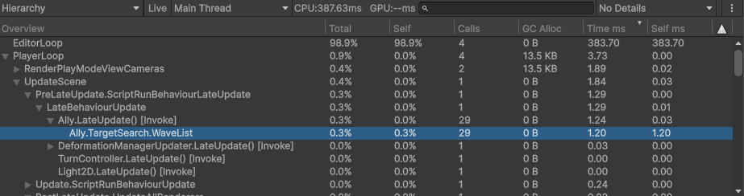
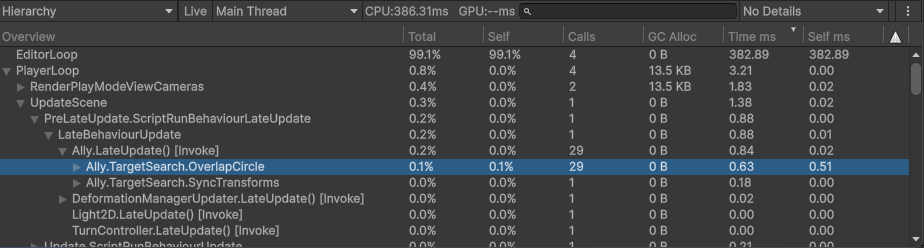

# 아군 공격 대상 탐색 프로파일링

측정일은 2026년 11월 9일이다. `ThrowYut` 씬에서 아군의 공격 대상을 찾는 두 방식을 Unity Profiler의 `CPU Usage → Hierarchy → Main Thread`에서 비교했다.

## 테스트 조건

- 아군은 도 아군(`AllyWarriorDo`) 29마리다. 윷판 29칸에 한 마리씩 고루 배치했다.
- 웨이브의 적은 총 1,000마리이며, 0.1초 간격으로 순차 등장한다. 각 프레임의 동시 활성 적 수는 캡처에서 별도로 집계하지 않았다.
- `Wave List`는 웨이브의 적 목록을 순회한다. `Overlap Circle`은 물리 범위 검색으로 후보를 찾은 뒤 같은 중심 거리 기준으로 대상을 고른다.

## 스크린샷에 표시된 프레임

| 방식 | Profiler 마커 | Calls | Time ms | GC Alloc |
| --- | --- | ---: | ---: | ---: |
| Wave List | `Ally.TargetSearch.WaveList` | 29 | 1.20 ms | 0 B |
| Overlap Circle | `Ally.TargetSearch.OverlapCircle` | 29 | 0.63 ms | 0 B |
| Overlap Circle | `Ally.TargetSearch.SyncTransforms` | 1 | 0.18 ms | 0 B |

스크린샷에 표시된 자릿수로 계산하면, `Overlap Circle`은 물리 동기화까지 합해 약 **0.81 ms**다. `Wave List`의 **1.20 ms**보다 약 **0.39 ms(32.5%)** 적다. 각 시간은 아군 29마리의 탐색을 한 프레임에서 합산한 값이다.

**Wave List**

**Overlap Circle**

## 캡처 전체 집계

각 캡처의 2,000프레임에서 대상 탐색이 매 프레임 29회 기록됐다. `Overlap Circle`은 프레임별로 탐색과 물리 동기화 시간을 더한 뒤 통계를 계산했다.

| 캡처 | 프레임당 평균 | 중앙값 | 95백분위 |
| --- | ---: | ---: | ---: |
| `12-09-21` · Wave List | 1.178 ms | 1.167 ms | 1.236 ms |
| `12-12-18` · Overlap Circle + SyncTransforms | 0.825 ms | 0.813 ms | 0.883 ms |

캡처 전체에서 `Overlap Circle`의 대상 탐색 비용은 평균 **0.353 ms(약 30%)** 적었다. 두 캡처의 프레임을 적 수와 위치로 맞춰 비교하지 않았으므로, 이 수치는 기록된 구간 전체의 비교다.

원본 캡처는 측정한 PC의 `ProfilerCaptures/`에 보관한다.

- Wave List · `청취사_1차_4팀_프로젝트_2026-11-09_12-09-21.data`
- Overlap Circle · `청취사_1차_4팀_프로젝트_2026-11-09_12-12-18.data`

## 대상 유지 적용 후 Overlap Circle과 Trigger 비교

2026년 11월 9일, Unity 6.3 LTS(6000.3.28f1)의 배치 모드에서 `ThrowYut` 복사본을 실행했다. 렌더링을 끄고 게임 시간은 프레임당 1/60초로 진행했다. 아군 29마리와 적 1,000마리, 등장 간격 0.1초를 유지했다. 두 방식 모두 현재 대상이 유효하면 유지하고, 대상이 없을 때만 가장 가까운 적을 고른다.

초기화 프레임을 제외하고 마지막 적의 풀 반환까지 모드별 8,026프레임을 집계했다. 두 실행의 프레임별 누적 등장 수와 반환 수는 모두 일치했다. 아군이 대상을 보유한 수는 두 실행 모두 프레임당 평균 약 21.95마리였다.

| 프레임당 메인 스레드 경과 시간 | Overlap Circle | Trigger |
| --- | ---: | ---: |
| 아군 `LateUpdate` 평균 | 0.126 ms | 0.032 ms |
| 2D 물리 루프 평균 | 0.023 ms | 1.815 ms |
| 적 풀 반환 평균 | 0.001 ms | 0.003 ms |
| 합계 평균 | **0.150 ms** | **1.850 ms** |
| 합계 95백분위 | 0.207 ms | 2.871 ms |

`LateUpdate`에는 대상 유효성 검사와 새 대상 선택, Overlap Circle 모드의 명시적 물리 동기화가 포함된다. 2D 물리 루프와 풀 반환을 별도로 재어 Trigger 콜백과 접촉 처리 비용을 포함했다. Trigger 실행에서는 진입 콜백으로 후보가 총 31,000번 등록됐다.

이 배치에서는 Trigger가 아군 스크립트 시간을 줄였지만, 물리 처리 시간이 늘어 측정 구간의 합계는 Overlap Circle이 평균 **1.700 ms/프레임** 적었다. 측정값은 렌더링을 제외한 배치 실행의 해당 구간 경과 시간이며, 위의 기존 Profiler 캡처와 측정 범위가 다르다.
