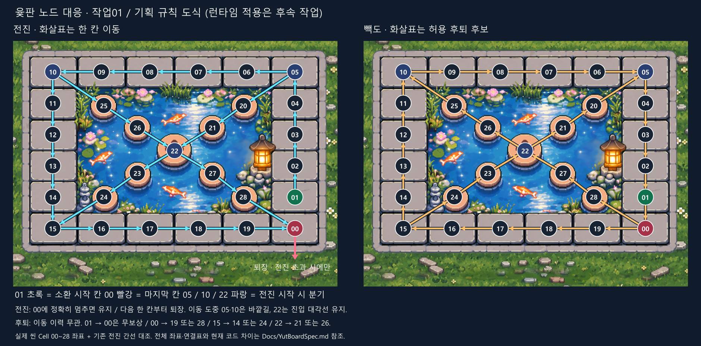

# 윷판 명세

[명세 색인](README.md) · [턴 흐름](TurnSpec.md) · [윷 행동](YutActionSpec.md) · [구현 작업표](ImplementationGaps.md)

## 기준과 확인 범위

- 기준: [개발 전달본 v1.3 탭 4, 04장](https://docs.google.com/document/d/1hI6NtOWNZ2KTU-vgrUT0q4KMR9PjlM2E5JoXmvvcwuU/edit?tab=t.blkk5zag95yu). 2026-11-18에 원문을 다시 내보내 확인했다.
- 작업01은 실제 맵·씬·코드의 번호와 연결을 대조하는 **개발 문서 작업**이다. 아래 기획 규칙의 도식화가 후퇴·퇴장 기능의 런타임 구현 완료를 뜻하지 않는다. 작업06에서 후퇴를, 작업08에서 퇴장을 연결한다.
- 아군의 칸 이동과 적의 고정 이동 경로는 별개다. 이 문서의 화살표는 아군 경로만 나타낸다.

## 실제 맵 위 노드 도식



[도식을 별도로 열기](Diagrams/YutBoardNodes.svg). 왼쪽은 전진, 오른쪽은 빽도다. 초록 01은 소환 시작 칸, 빨강 00은 마지막 칸, 파랑 05·10·22는 전진 이동을 시작할 때 경로를 선택하는 분기다. 화살표 하나가 한 칸이며, 퇴장 화살표는 새 보드 칸이 아닌 보드 밖 경계를 나타낸다. 퇴장 안내 UI 위치는 작업08에서 연결할 대상이다.

```text
10 ← 09 ← 08 ← 07 ← 06 ← 05
↓  ↘                     ↙  ↑
11   25                 20   04
↓      ↘               ↙    ↑
12       26          21      03
↓          ↘        ↙       ↑
               22
↓          ↙        ↘       ↑
13       23          27      02
↓      ↙               ↘    ↑
14   24                 28   01 ← 소환 시작
↓  ↙                     ↘
15 → 16 → 17 → 18 → 19 → 00 ← 마지막
                             ↓ 전진 초과
                            퇴장
```

ASCII의 세로 화살표는 바깥길을 나타낸다. `00 → 01` 전진은 허용하지 않는다. 빽도 방향은 SVG 오른쪽과 아래 연결표를 따른다.

## 시작·마지막·퇴장 경계

- **시작 칸 = Cell 01**: 전통 윷놀이의 첫 도 위치다. 일반 유닛과 특별전투유닛의 공통 소환 위치이며 별도 대기 칸은 없다. 현재 일반 소환의 `DeploymentCellId = 1`과 일치한다.
- **마지막 칸 = Cell 00**: 오른쪽 아래 모서리다. 바깥길 `19 → 00`, 지름길 `28 → 00`이 합류한다. 정확히 도착하면 유닛·점유를 유지하고 보상은 없다.
- **전진으로 00을 넘어가면 퇴장**한다. `19 + 도 → 00에 정지`, `19 + 개 이상 → 퇴장`, `28 + 도 → 00에 정지`, `28 + 개 이상 → 퇴장`, `00 + 전진 결과 → 퇴장`이다. 남는 걸음 수로 다음 바퀴를 돌지 않는다.
- **01에서 빽도는 00에 정지**한다. 퇴장·재화 지급은 없다. 00에서 다시 빽도라면 19 또는 28을 선택한다. 이전 이동 이력은 후보를 제한하지 않는다.
- 현재 코드의 `YutBoard.StartCellId = 0`은 기존 순환 그래프의 기준점 이름이다. **기획의 소환 시작 칸이라는 뜻으로 사용하지 않는다.** 작업06·08에서 이를 참조하는 경로·이력 코드를 함께 정리한다. 이번 문서 작업에서 상수값만 바꾸어 기존 이력을 변형하지 않는다.

## 전진과 허용 후퇴

전진은 기존 `YutBoard.NextCells`의 실제 간선과 배경의 연결을 대조했다. 확정된 마지막 칸 경계를 반영해 기존 `00 → 01` 순환 연결을 `00 → 퇴장`으로 구분한다. 아래 빽도 표는 이 경계를 반영한 전진 간선의 역방향에 **04장의 시작 칸 예외 `01 → 00`**를 명시한 대응이다. 그림에서 가까워 보이는 칸이나 과거 방문 칸을 임의로 추가하지 않는다.

| 현재 칸/상황 | 전진 규칙 | 빽도 규칙 |
| --- | --- | --- |
| 05에서 이동 시작 | 06(바깥길) 또는 20(지름길) | 04만 허용 |
| 10에서 이동 시작 | 11(바깥길) 또는 25(지름길) | 09만 허용 |
| 22에서 이동 시작 | 23(왼쪽 아래) 또는 27(오른쪽 아래) | 21 또는 26 |
| 이동 도중 05·10 통과 | 각각 06·11로 진행; 새 분기 선택 없음 | 빽도는 한 칸 이동이므로 통과 분기 없음 |
| 이동 도중 22 통과 | 직전 칸이 21이면 23, 26이면 27 | 이동 이력을 묻지 않고 위의 두 후보 적용 |
| 15 | 16 | 14 또는 24 |
| 01 | 02 | 00; 무보상 |
| 00 | 다음 한 칸부터 퇴장 | 19 또는 28; 무보상 |

전진 예: `04 + 걸 = 05 → 06 → 07`이며 20으로 꺾지 않는다. `20 + 걸 = 21 → 22 → 23`, `25 + 걸 = 26 → 22 → 27`이다. `22 + 개`는 `23 → 24`와 `27 → 28` 두 후보가 된다. 중앙에서 20·25·24·28로 직접 이동하는 간선은 없다.

## Cell 번호·좌표·한 칸 연결 대응표

`ThrowYut` 씬의 29개 `YutCell.cellId`와 GameObject 이름을 대조했다. 현재 보드 부모와 그 상위 Transform은 위치 0·회전 0·배율 1이므로 표의 로컬 X/Y가 월드 X/Y와 같다. 모든 Cell의 Z는 0이다.

배경 `Assets/Art/Background/Background.png`는 1920×1080, PPU 100, 중심 (0, 0), 배율 0.925926이다. 배경 픽셀에서 월드로는 `((px - 960) / 108, (540 - py) / 108)`, 월드에서 픽셀로는 `(960 + 108x, 540 - 108y)`로 대응하며 픽셀 표시는 정수로 반올림했다. 배경 SpriteRenderer의 Z=10은 아군 Cell의 Z=0과 구분한다.

표의 **전진과 빽도는 구현 목표 그래프**다. 현재 코드 차이는 다음 절에 기록한다.

| Cell | 월드 X | 월드 Y | 배경 픽셀 X,Y | 전진 1칸 | 허용 빽도 |
| --- | ---: | ---: | --- | --- | --- |
| 00 | 0.250000 | -2.666667 | 987, 828 | 퇴장 | 19, 28 |
| 01 | 0.250000 | -1.824074 | 987, 737 | 02 | 00 |
| 02 | 0.250000 | -0.981481 | 987, 646 | 03 | 01 |
| 03 | 0.250000 | -0.138889 | 987, 555 | 04 | 02 |
| 04 | 0.250000 | 0.703704 | 987, 464 | 05 | 03 |
| 05 | 0.250000 | 1.546296 | 987, 373 | 06, 20 | 04 |
| 06 | -1.046296 | 1.546296 | 847, 373 | 07 | 05 |
| 07 | -2.342593 | 1.546296 | 707, 373 | 08 | 06 |
| 08 | -3.648148 | 1.546296 | 566, 373 | 09 | 07 |
| 09 | -4.944444 | 1.546296 | 426, 373 | 10 | 08 |
| 10 | -6.250000 | 1.546296 | 285, 373 | 11, 25 | 09 |
| 11 | -6.250000 | 0.703704 | 285, 464 | 12 | 10 |
| 12 | -6.250000 | -0.138889 | 285, 555 | 13 | 11 |
| 13 | -6.250000 | -0.981481 | 285, 646 | 14 | 12 |
| 14 | -6.250000 | -1.824074 | 285, 737 | 15 | 13 |
| 15 | -6.250000 | -2.666667 | 285, 828 | 16 | 14, 24 |
| 16 | -4.944444 | -2.666667 | 426, 828 | 17 | 15 |
| 17 | -3.648148 | -2.666667 | 566, 828 | 18 | 16 |
| 18 | -2.342593 | -2.666667 | 707, 828 | 19 | 17 |
| 19 | -1.046296 | -2.666667 | 847, 828 | 00 | 18 |
| 20 | -1.138889 | 0.638889 | 837, 471 | 21 | 05 |
| 21 | -1.962963 | 0.046296 | 748, 535 | 22 | 20 |
| 22 | -2.981481 | -0.574074 | 638, 602 | 23, 27 | 21, 26 |
| 23 | -3.981481 | -1.175926 | 530, 667 | 24 | 22 |
| 24 | -4.879630 | -1.814815 | 433, 736 | 15 | 23 |
| 25 | -4.879630 | 0.638889 | 433, 471 | 26 | 10 |
| 26 | -3.981481 | 0.046296 | 530, 535 | 22 | 25 |
| 27 | -1.962963 | -1.175926 | 748, 667 | 28 | 22 |
| 28 | -1.138889 | -1.814815 | 837, 736 | 00 | 27 |

## 현재 구현과 후속 작업

| 대조 대상 | 현재 확인한 구현 | 후속 작업 |
| --- | --- | --- |
| 일반 소환 | `YutActionController.DeploymentCellId = 1` | 일반 소환 위치는 유지; 특별소환도 01에 연결(작업27) |
| 전진 분기 | `YutBoard.GetForwardPaths/GetNextCells`가 05·10·22의 시작 분기와 통과 방향 처리 | 기존 경로를 유지하며 00 초과를 퇴장으로 연결(작업08) |
| 마지막 칸 | 현재 `NextCells[0] = {1}`로 다음 바퀴 순환 | 00 정지와 초과 퇴장을 구분(작업08) |
| 빽도 | `travelHistory`의 직전 칸 하나 사용, 같은 직전 칸끼리 이동 묶음 구성 | 위의 허용 후퇴 표 사용; 이동 이력 제약 제거(작업06) |
| 업기 | 같은 종류·성급 전체 선택 | 최대 3기의 소속 묶음으로 선택(작업05) |
| 점유 | 개체 수 기준 최대 6, 이동 전체의 공간 재검사 | 일반 1·2성 인구1/백호 인구3의 합계 상한6 적용(작업04·25) |
| 칸 안 배치 | 가로3열×세로2행, 왼쪽 위부터 채우고 빈자리 당김 | 백호 인구3 자리 표현 연결(작업25) |

가득 찬 칸은 후보에서 제외하고 이동 확정 시에도 묶음 전체의 수용량을 재검사한다. 부분 이동은 허용하지 않는다. 소환 공간이 부족하면 생성하지 않고 결과를 유지한다. 이 조건과 완주 규칙은 이미 확정되어 있으므로 이전 문서의 ‘미정 규칙’에서 제외했다. 칸 인구·미리보기 UI는 작업09·25에서 연결한다.

## 작업01 검증 기록 (2026-11-18)

- 원문04장, 실제 배경 이미지, `ThrowYut.unity`, `YutCell`, `YutBoard`, `YutActionController`를 대조했다.
- `python Tools/GenerateYutBoardDiagram.py`로 29개 이름/ID의 유일성·연속성, Z=0, 부모의 원점/회전/배율, 전진 간선의 참조 범위와 분기, 시작·마지막의 후퇴 연결을 검사하고 실제 좌표에서 SVG를 생성한다. 표의 값도 같은 실행 출력에 대응한다.
- SVG를 Sharp로 1880×930 PNG로 렌더링하고 실제 배경의 각 칸에 번호가 맞는지, 전진·후퇴 화살표와 퇴장 경계가 읽히는지 확인했다. PNG는 해당 SVG의 표시용 사본이다.
- 도식과 좌표표는 정적 대조의 근거다. 게임 코드·씬·프리팹은 이번 작업에서 수정하지 않는다. Play Mode/빌드 검증은 이번 문서 작업의 완료 근거에 포함하지 않는다.
