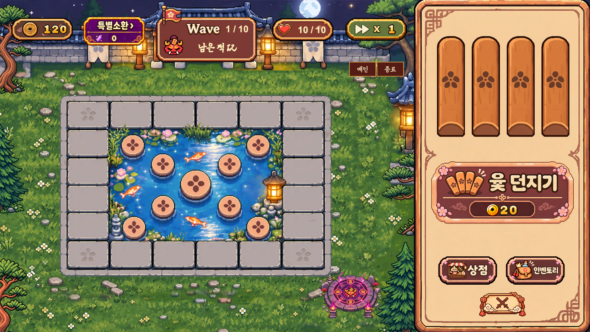

# 윷웨디

**윷을 던져 아군을 소환하고, 윷판 위에서 진형을 바꿔 적의 웨이브를 막는 2D 디펜스 게임**입니다. 같은 윷 결과도 새 유닛을 배치하는 데 쓸지, 이미 배치한 유닛을 유리한 칸으로 옮기는 데 쓸지 선택할 수 있습니다.

## 플레이 방법

1. **윷을 던집니다.** 준비 단계에서 일반 재화를 써 윷을 던집니다. 결과에 따라 아군을 소환하거나, 배치된 아군과 도착할 칸을 차례로 선택해 이동합니다. 백도는 한 칸 후퇴하는 데 사용합니다.
2. **아군을 배치합니다.** 갈림길에서 경로를 골라 아군의 위치를 조정합니다. 같은 칸에 같은 종류의 1성 유닛 3기를 모으면 2성 유닛으로 진화시킬 수 있습니다.
3. **전투를 시작합니다.** 배치를 마치고 전투 시작 버튼을 누르면 아군이 지나가는 적을 자동으로 공격합니다. 적을 놓치면 하트를 잃고, 하트가 남아 있으면 다음 웨이브 준비로 넘어갑니다.
4. **마지막 보스를 막습니다.** 10번째 웨이브의 보스를 쓰러뜨리면 승리합니다. 하트가 모두 줄거나 최종 보스가 탈출하면 패배합니다.

적 처치와 웨이브 완료로 얻은 일반 재화는 윷 던지기나 상점 아이템 구매에 쓸 수 있습니다. 아군이 윷판을 완주하면 특별 재화를 얻을 수 있으며, 특별 소환으로 백호를 배치할 수 있습니다.

## 프로젝트 열기

청취사 1차 4팀에서 Unity `6000.3.28f1`과 Universal 2D로 제작했습니다.

1. Unity Hub에서 Unity Editor `6000.3.28f1`을 설치하고 이 저장소를 복제합니다.
2. Unity Hub의 **Projects → Add**에서 `Assets`, `Packages`, `ProjectSettings`가 있는 저장소 폴더를 선택합니다.
3. `Assets/Scenes/Title.unity`를 열고 **Play**를 누른 뒤, 타이틀 화면에서 **게임 시작**을 선택합니다.

에셋을 추가하거나 옮길 때는 Unity의 `.meta` 파일을 함께 커밋합니다.

게임 규칙과 구현 기록은 [프로젝트 문서](Docs/README.md)에서 확인할 수 있습니다.
